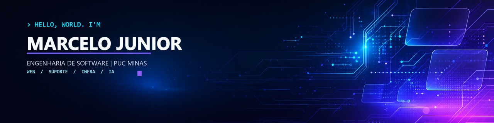

<div align="center">



<br/>


<br/>

[](#vamos-conversar)
[](https://www.linkedin.com/in/marcelogojunior)
[](mailto:contatomarcelojr@outlook.com)

</div>

---

## `01 // SOBRE MIM`

Sou estudante de **Engenharia de Software na PUC Minas**, em transição ativa para tecnologia. Minha trajetória une mais de **4 anos trabalhando com pessoas, processos, atendimento técnico e múltiplos sistemas** a uma formação prática em desenvolvimento web, suporte técnico, infraestrutura e fundamentos de engenharia de software.

Atualmente, também atuo na **comunicação oficial do curso de Engenharia de Software da PUC Minas**, criando conteúdo digital, cobrindo eventos e explorando ferramentas de **Inteligência Artificial generativa** na produção audiovisual.

Hoje, busco oportunidades de entrada em tecnologia nas áreas de **Front-end, Suporte Técnico, Infraestrutura e TI Corporativa**. A longo prazo, minha meta é construir uma **carreira internacional até 2030**, direcionando minha evolução para áreas como Cloud Computing, IA/MLOps, SRE/DevOps, Cibersegurança ou Dados.

```javascript
const marcelo = {
  local: "Belo Horizonte, MG",
  curso: "Eng. de Software",
  faculdade: "PUC Minas",
  experiencia: [
    "Suporte N1",
    "Troubleshooting",
    "CRM", "ERP", "PDV"
  ],
  focoAtual: [
    "Front-end",
    "Suporte Técnico",
    "Infraestrutura",
    "TI Corporativa"
  ],
  estudando: [
    "JavaScript",
    "Python",
    "Git/GitHub",
    "Redes",
    "Linux",
    "Banco de Dados"
  ],
  trilhas2030: [
    "Cloud",
    "IA/MLOps",
    "SRE/DevOps",
    "Cibersegurança",
    "Dados"
  ],
  objetivo: [
    "Entrar em tecnologia",
    "Carreira global",
    "Especialização até 2030"
  ]
};
```

> Minha vantagem não é apenas aprender tecnologia: é entender o problema, comunicar a solução, investigar falhas com calma e conectar pessoas, processos e sistemas até a solução funcionar.

---

## `02 // TECH STACK`

### Desenvolvimento Web


`Responsividade` · `UI semântica` · `Organização de interfaces`

### Suporte, Sistemas e Infraestrutura


`PDV` · `Chamados` · `SLA` · `Atendimento técnico` · `Sistemas corporativos`

### Em evolução constante


`Cloud Fundamentals` · `Dados` · `Banco de Dados`

---

## `03 // PROJETO EM DESTAQUE`

### Trabalho Interdisciplinar: Aplicações Web


Desenvolvimento de interfaces web com **HTML5, CSS3 e JavaScript**, aplicando responsividade, usabilidade, estruturação semântica e organização de projeto em equipe. O projeto recebeu **nota 98/100** na avaliação do corpo docente.

**Competências aplicadas:** `Front-end` · `UI responsiva` · `Semântica` · `Git/GitHub` · `Trabalho em equipe` · `Resolução de problemas` · `Comunicação técnica`

---

## `04 // EXPERIÊNCIA APLICADA`

| Contexto | Período | Tecnologia na prática |
|---|:---:|---|
| **PUC Minas** — Comunicação do Curso de Engenharia de Software | Nov/2025 – atual | Conteúdo digital, produção audiovisual, IA generativa, cobertura de eventos e comunicação institucional |
| **TIM Brasil** | Jan/2025 – Out/2025 | Suporte N1, troubleshooting de redes móveis, chamados e CRM multi-sistema |
| **Vivo / Telefônica** | Jun/2023 – Set/2024 | Configuração de serviços digitais, gestão de SLA e atendimento técnico B2B/B2C |

Essa experiência fortaleceu competências essenciais para TI: **investigação de incidentes, comunicação técnica, leitura de processos, gestão de conflitos, atendimento ao usuário e atuação sob pressão**.

---

## `05 // FORMAÇÃO & DESENVOLVIMENTO`

🎓 **Bacharelado em Engenharia de Software — PUC Minas**  
`Em andamento` · Desenvolvimento Web · Algoritmos · Arquitetura de Computadores · Modelagem de Processos · Fundamentos de Engenharia de Software

💡 **We Make Software 2026 — Projeto Foca+**  
`Participação em comunidade, inovação e desenvolvimento de solução digital aplicada`

📌 **Foco acadêmico e técnico de longo prazo**  
`Programação` · `Redes` · `Sistemas` · `Cloud` · `IA/MLOps` · `SRE/DevOps` · `Cibersegurança` · `Dados` · `Inglês técnico`

---

## `06 // ROTA GLOBAL 2030`

Até **2030**, minha meta é consolidar uma base técnica sólida em Engenharia de Software e direcionar minha carreira para uma das áreas mais estratégicas do mercado global de tecnologia:


Meu objetivo é transformar minha formação acadêmica, experiência com suporte, comunicação técnica e projetos práticos em uma **carreira internacional**, buscando oportunidades em mercados com forte demanda por profissionais de tecnologia.

### Roadmap pessoal

- **2026–2027** → Fortalecer fundamentos em programação, desenvolvimento web, redes, sistemas, Linux, banco de dados e inglês técnico.
- **2028–2029** → Construir projetos mais robustos, buscar estágio ou posição júnior e aprofundar Cloud, Segurança, Dados, DevOps e IA aplicada.
- **2030** → Concluir a graduação e estar preparado para atuar profissionalmente em uma trilha técnica com potencial global.

> Não pretendo apenas acompanhar o futuro da Engenharia de Software, mas me preparar para construir parte dele.

---

## `07 // GITHUB ANALYTICS`

<div align="center">


</div>

---

<a id="vamos-conversar"></a>

## `08 // VAMOS CONVERSAR`

Busco uma oportunidade de **estágio ou posição inicial** em Desenvolvimento Front-end, Suporte Técnico, Infraestrutura, Segurança da Informação ou TI Corporativa, em modelo presencial, híbrido ou remoto.

Quero transformar minha primeira oportunidade formal em tecnologia no início de uma jornada de especialização até 2030, com foco em **crescimento técnico, atuação internacional e impacto real em produtos, sistemas e pessoas**.

<div align="center">

[](https://www.linkedin.com/in/marcelogojunior)
[](mailto:contatomarcelojr@outlook.com)
[](https://github.com/engsoftmarcelo)

<br/>

`</> construindo, aprendendo e evoluindo um commit de cada vez`

</div>
