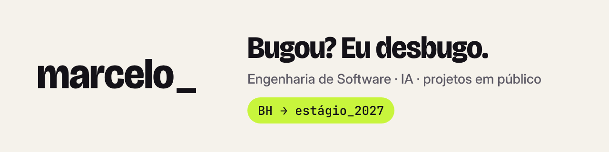

<picture>
  <source media="(prefers-color-scheme: dark)" srcset="./github-cabecalho-escuro.png">
  
</picture>

# Oi, eu sou o Marcelo

Estudante de Engenharia de Software na PUC Minas, em BH.
Explorando engenharia de software e IA enquanto construo projetos em público.

- Construindo: ClickSeguro
- Aprendendo: Java, Spring Boot, APIs REST, HTML, CSS, JavaScript, Git/GitHub e fundamentos de UX/UI.
- Conteúdo: @engsoftmarcelo
- PT-BR · learning English

Projetos em destaque ↓
